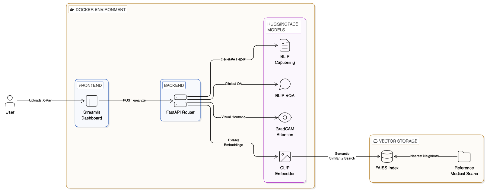

# MedVision-LM: Medical Visual Language Model Assistant

[](https://www.python.org/downloads/)
[](https://fastapi.tiangolo.com)
[](https://huggingface.co/docs/transformers/index)

**MedVision-LM** is a production-grade multimodal AI assistant for medical image analysis. It leverages state-of-the-art vision-language models (VLMs) fine-tuned on real medical datasets to provide automated insights from medical scans.

## Features

- 📝 **Automated Image Captioning:** Generates descriptive clinical reports from chest X-rays using a fine-tuned BLIP model.
- ❓ **Visual Question Answering (VQA):** Answers specific clinical questions about a scan (e.g., "Is there consolidation?").
- 🔍 **Cross-Modal Retrieval:** Uses CLIP embeddings and FAISS to find and retrieve the most similar reference cases to a given input image.
- 🔥 **Attention Visualization:** Highlights diagnostically relevant regions using GradCAM-style attention heatmaps.
- 🚀 **Production-Ready API:** Served via a high-performance FastAPI back-end.
- 🖥️ **Interactive Demo:** Streamlit-based UI for easy interactive evaluation.

---

## Datasets
The project uses the following datasets:
*   [IU X-Ray](https://openi.nlm.nih.gov/) (Indiana Univ.): image-report pairs.
*   [ROCO](https://github.com/razorx89/roco-dataset) (Radiology Objects in COntext): Large-scale VLM training dataset.
*   [VQA-RAD](https://vqa-rad.github.io/): Medical visual question answering.

---

## Architecture



---

## Quickstart

### 1. Installation

```bash
# Clone the repository
git clone https://github.com/ashiksharonm/MedVision-LM.git
cd MedVision-LM

# Create and activate a virtual environment
python -m venv venv
source venv/bin/activate  # On Windows: venv\Scripts\activate

# Install dependencies
pip install -r requirements.txt
```

### 2. Prepare Data
```bash
python data/download_iuxray.py
python data/preprocess.py
```

### 3. Run the API & UI
```bash
# Start FastAPI backend
uvicorn src.api.main:app --host 0.0.0.0 --port 8000 --reload

# Start Streamlit UI (in a new terminal)
streamlit run app/streamlit_demo.py
```

---

## Deployment (Docker)

```bash
docker-compose up --build
```
